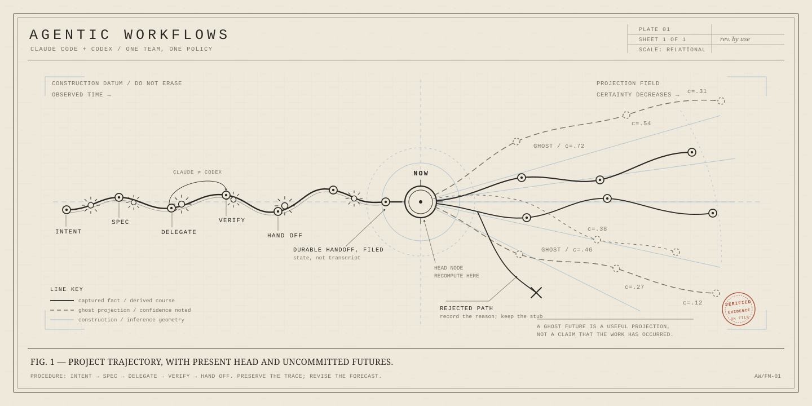

<p align="center">
  
</p>

<h1 align="center">Agentic Workflows</h1>

<p align="center">
  <strong>How I run Claude Code and Codex as one engineering team.</strong><br>
  The workflows, gates, and handoff formats I use every day, exported from my private control plane and sanitized into a copyable kit.
</p>

<p align="center">
  <a href="#current-stack-as-of-november-2026"><strong>Current stack</strong></a>
  ·
  <a href="#pick-your-workflow">Pick a workflow</a>
  ·
  <a href="#see-one-run">See one run</a>
  ·
  <a href="docs/diagrams.md">See the system</a>
  ·
  <a href="templates/AGENTS.md">Copy the agent guide</a>
</p>

<p align="center">
  <a href="LICENSE"></a>
  <a href="https://github.com/nathanmauro/agentic-workflows/actions/workflows/audit.yml"></a>
  
  
</p>

---

> **A good model can write code. A good operating system gets the code shipped.**

Coding agents rarely fail because they cannot produce a plausible diff. They fail because the work around the model is improvised: context is scattered, mutation boundaries are fuzzy, verification is optional, and the next session has to reconstruct everything from scratch.

This repo is the control layer I run around two agents. It is process, not product: the systems these patterns write to live in their own repos, starting with [Black Box](https://github.com/nathanmauro/black-box), the shared memory both agents record decisions and handoffs into. It was built with the workflows it documents. Claude Code and Codex draft and verify; I scope, review, and own every commit.

## Current stack (as of November 2026)

- **Two session engines, one policy, and a stateless specialist oracle.** Claude Code (**Opus 5.5** at `medium` effort by default, `high` when needed; **Sonnet 5.5 / Haiku 5.5** for mechanical lookups and edits) and Codex (**gpt-6-astra** at `medium` effort interactively; **gpt-6.1-sol** for delegated builds) conduct, implement, and cross-verify. The model that did not write the code verifies it. **Fable 5.2** is queried as a stateless, zero-tool First-Principles Oracle (`physics`, `strategy`, `architecture`, `redteam`) rather than an interactive session driver: stripping tool/MCP schemas and compliance boilerplate cuts its quota burn by ~80% and stops it from hedging on unmeasured parameters. One [shared operating policy](templates/portable-policy.md) governs every client: Claude Code imports it, Codex and Gemini carry it as a hash-marked rendered block, and a multi-ring drift check fails when policy hashes, skill symlinks, hooks, docs, or decision records fall out of sync.
- **Either engine can lead.** Interactive sessions run as spaces and tabs in [Herdr](https://herdr.dev) (`herdr-app` for window placement, `hc` for terminal lifecycle and inspection) with Remote Control on, carrying the human's authorization with the task. Claude hands Codex bounded turns over a [supervised channel](docs/concepts/supervised-delegation.md): a turn record per send, a one-line result envelope, and an exit code the conductor acts on instead of guessing from silence.
- **Where state lives.** Interactive sessions run in Herdr spaces, one per checkout, agents as tabs; unattended fleet workers run in run-scoped tmux sessions. Linear holds execution. Obsidian holds durable notes and parked ideas. [Black Box](https://github.com/nathanmauro/black-box) holds decisions, handoffs, and projections across clients over MCP.
- **Cost, startup hygiene, and backpressure.** Interactive drivers default to `medium` effort; attended Codex delegation runs on the fast tier at `high` effort; unattended fleet rounds run on the standard tier at `xhigh`. Unused global MCP servers and zero-use skills are pruned on a regular audit cadence to save thousands of prompt tokens per turn, and autonomous background queues carry explicit ready-backlog caps so agent output never outruns human review.

Last reviewed 2026-11-10.

## What it demonstrates

- **Supervised delegation.** A worker channel with send/watch separation, a result envelope, bounded attention, and a sandbox that keeps `.git` read-only so the human stays sole author. [Concept](docs/concepts/supervised-delegation.md) · [public adapter](scripts/codex-runner) · [skill](skills/codex-workflow-hybrid/SKILL.md)
- **Stateless specialist isolation.** Separating multi-turn tool orchestration from zero-tool first-principles reasoning (`explore` mode and stateless oracle calls), so deep derivations and adversarial red-teams do not re-bill 100k+ tokens of tool schemas per command. [Concept](docs/concepts/execution-path-triage.md)
- **Consent that survives handoffs.** The human's exact words, their source, the destination, the payload, and the limits travel with every delegated task to the final reviewed tool call. [Concept](docs/concepts/authorization-provenance.md)
- **Policy as code.** One policy source, one skill source, imported by Claude Code and rendered into Codex and Gemini as hash-marked blocks, backed by a multi-ring drift audit across policy, skill links, hooks, docs, and continuity records. [Concept](docs/concepts/one-policy-two-engines.md) · [template](templates/portable-policy.md) · [skill registry](templates/skill-registry.md)
- **Fail-closed release gates and queue backpressure.** A fleet that merges its own green PRs only through a helper that re-checks mode, round, repo identity, PR head, and danger hints before and after CI, plus backlog caps that pause unattended generation when unreviewed output piles up. [Skill](skills/codex-fleet/SKILL.md) · [workflow](docs/workflows/codex-fleet.md)
- **Continuity that compounds without write-only bloat.** Compact handoffs written when state would be lost by `git log` alone, typed decisions with rejected alternatives, closeout handoffs reused directly as session summaries without an extra model call, and projections that assemble into a project trajectory. [Concept](docs/concepts/handoffs-and-continuity.md) · [trajectory](docs/concepts/project-trajectory.md)
- **Choosing the lean path.** A main-loop triage gate and an anti-rabbit-hole gate that pick the stage, engine, and work mode (`prototype`, `sdlc`, or read-only `explore`) before anything heavy runs, after one default-to-heavy run burned 11.75M tokens for no diff. [Concept](docs/concepts/execution-path-triage.md)

## See one run

- A [supervised Codex turn](examples/supervised-delegation/), recorded while this repo was being updated: the task, the turn record, the failed envelope with exit code 11, the inspection that chose not to retry, and the same fault reproduced with the public adapter on a smoke probe.
- A [council review transcript](examples/council-review/transcript.md): one context pack, three independent opinions, anonymized cross-review, a recorded decision.
- A [fleet round board](examples/fleet-round/board.txt) and the [handoff](examples/durable-handoff/handoff.md) a session leaves behind.

## The core loop

```text
INTENT  →  SPEC  →  DELEGATE  →  VERIFY  →  HAND OFF
  ↑                                              │
  └──────────────────── learn ───────────────────┘
```

| Without a workflow                        | With an operating system                                                 |
| ----------------------------------------- | ------------------------------------------------------------------------ |
| Every session starts cold                 | Project instructions, living specs, and a memory adapter restore intent  |
| "Looks good" becomes the acceptance bar   | Commands, artifacts, and a second model provide proof                    |
| Agents collide in one giant context       | A conductor assigns one bounded slice per agent, one writer per checkout |
| Decisions disappear into transcripts      | Compact handoffs and typed decisions make the next action obvious        |
| Push, deploy, and live writes are implied | Explicit gates fail closed before mutation                               |

## Pick your workflow

Both engines conduct. Each row names the Claude-led and the Codex-led path.

| Need                              | Claude-led                                                                                                                                                                                | Codex-led                                                                                                                   |
| --------------------------------- | ----------------------------------------------------------------------------------------------------------------------------------------------------------------------------------------- | --------------------------------------------------------------------------------------------------------------------------- |
| Decide how to work before working | [Execution-path triage](docs/concepts/execution-path-triage.md) (`/route`, `/work-mode`)                                                                                                  | Same gate, `$route` and `$work-mode`                                                                                        |
| Delegate a bounded build          | [Codex from Claude](docs/workflows/codex-from-claude.md): [`codex-workflow-hybrid`](skills/codex-workflow-hybrid/SKILL.md) · [`codex-workflow-lean`](skills/codex-workflow-lean/SKILL.md) | [Claude from Codex](docs/workflows/claude-from-codex.md): [`claude-remote`](skills/claude-remote/SKILL.md)                  |
| Advance several repos at once     | [Codex fleet](docs/workflows/codex-fleet.md): Claude conducts, one Codex session per project                                                                                              |                                                                                                                             |
| Settle a consequential decision   | [Council review](docs/concepts/council-review.md)                                                                                                                                         | [`council`](skills/council/SKILL.md) (`$council`)                                                                           |
| Run a whole session               | [Agentic operating system](docs/concepts/agentic-operating-system.md)                                                                                                                     | [Codex-led session](docs/workflows/codex-led-session.md) (`$baton`, `/prompts:reseed`, `/prompts:handoff`, `/prompts:ship`) |
| Leave work in a trustworthy state | [Closeout and handoff](docs/workflows/closeout-and-handoff.md)                                                                                                                            | Same closeout, captured from Codex                                                                                          |

<p align="center">
  <a href="docs/diagrams.md"><strong>Explore the visual workflow gallery →</strong></a>
</p>

## Start small

You do not need a fleet on day one. Start with one project guide, one acceptance bar, and one clean handoff.

```bash
git clone https://github.com/nathanmauro/agentic-workflows.git ~/agentic-workflows

# From an existing project:
cp ~/agentic-workflows/templates/AGENTS.md ./AGENTS.md
cp ~/agentic-workflows/templates/HANDOFF.md ./HANDOFF.md
```

Then adapt three things in `AGENTS.md`:

1. Name the command that proves a change works.
2. State which mutations need an explicit gate.
3. Require a handoff when work remains.

When a second agent joins, add the [shared policy](templates/portable-policy.md), import it into Claude Code, and render it into Codex. When the project grows, add the [living spec](templates/project-spec.md). Graduate to fleet or council workflows only when the coordination cost is real.

## What is in the kit

```text
agentic-workflows/
├── skills/       portable workflows and runnable helper scripts, with fixture tests
├── templates/    agent guides, the shared policy, living specs, handoffs, adapters, a skill registry
├── examples/     sanitized fleet, council, continuity, and supervised-delegation artifacts
├── docs/         concepts, step-by-step workflows, diagrams, kindred systems
├── scripts/      a fail-closed public-release audit (runs in CI) and the codex-runner adapter
└── CHANGELOG.md  dated record of what changed and when the stack was last reviewed
```

### Copyable foundations

- [`portable-policy.md`](templates/portable-policy.md): the one operating policy both agents load: judgment, code style, git authority, authorization across handoffs, where state lives.
- [`AGENTS.md`](templates/AGENTS.md): a compact per-project contract for scope, verification, mutation tiers, and continuity.
- [`project-spec.md`](templates/project-spec.md): durable intent plus live round state, decisions, and deferred work.
- [`HANDOFF.md`](templates/HANDOFF.md): the exact state a future session needs, including the authorization it carries.
- [`skill-registry.md`](templates/skill-registry.md): the contract a skill meets before it earns prompt surface.
- [`local-adapters.example.json`](templates/local-adapters.example.json): clean boundaries for memory, notifications, session launchers, workers, and policy rendering.

### Working patterns

- [`codex-fleet`](skills/codex-fleet/SKILL.md): conductor-led, multi-project rounds with living specs, a review board, run-scoped state, and fail-closed push and merge gates.
- [`codex-workflow-hybrid`](skills/codex-workflow-hybrid/SKILL.md): Codex implements over the supervised channel; Claude orchestrates and verifies.
- [`codex-workflow-lean`](skills/codex-workflow-lean/SKILL.md): Codex implements and reviews; Claude is only the workflow engine and the git owner.
- [`claude-remote`](skills/claude-remote/SKILL.md): a Codex-led launch of a bounded Claude session in a Herdr pane, with the authorization record.
- [`council`](skills/council/SKILL.md): independent opinions, anonymized cross-review, neutral synthesis, a recorded pick. The public v0 documents the adapter contract; bring your own runner.
- [`codex-runner`](scripts/codex-runner): the public reference adapter for the supervised channel, headless over `codex exec`.

### Examples you can inspect

- [`supervised-delegation`](examples/supervised-delegation/): a real turn from this repo's own update, sanitized.
- [`fleet-round`](examples/fleet-round/): one conductor, two fictional projects, one vertical slice each.
- [`durable-handoff`](examples/durable-handoff/): compact state that another session can responsibly resume.
- [`council-review`](examples/council-review/): shared context, independent views, adversarial review, and a recorded decision.

## The principles

1. **Treat the harness as the product.** The model is one component. Instructions, tools, specs, gates, and feedback loops determine the outcome.
2. **Give every agent a lane.** One owner, one bounded slice, one acceptance bar, one writer per checkout. Parallelism without ownership is just faster confusion.
3. **Replace confidence with evidence.** A green command, an inspected diff, a verified user flow, or a second model's verdict beats a persuasive summary.
4. **Gate irreversible actions.** Commit, push, merge, deploy, message, and live-write paths are explicit and fail closed. A named workflow can carry a grant; nothing else widens one.
5. **Leave the system better informed.** Record decisions, handoffs, and the plausible futures you can see. Never secrets, raw logs, or entire transcripts.

## Read the field manual

| Learn the idea                                                                 | Put it into practice                                               |
| ------------------------------------------------------------------------------ | ------------------------------------------------------------------ |
| [Agentic operating system](docs/concepts/agentic-operating-system.md)          | [Closeout and handoff](docs/workflows/closeout-and-handoff.md)     |
| [Supervised delegation](docs/concepts/supervised-delegation.md)                | [Codex from Claude](docs/workflows/codex-from-claude.md)           |
| [Authorization provenance](docs/concepts/authorization-provenance.md)          | [Claude from Codex](docs/workflows/claude-from-codex.md)           |
| [One policy, two engines](docs/concepts/one-policy-two-engines.md)             | [Codex-led session](docs/workflows/codex-led-session.md)           |
| [Execution-path triage](docs/concepts/execution-path-triage.md)                | [Workflow diagram gallery](docs/diagrams.md)                       |
| [Fleet execution](docs/concepts/fleet-execution.md)                            | [Codex fleet](docs/workflows/codex-fleet.md)                       |
| [Living specs](docs/concepts/living-specs.md)                                  | [`project-spec.md`](templates/project-spec.md)                     |
| [Handoffs and continuity](docs/concepts/handoffs-and-continuity.md)            | [`HANDOFF.md`](templates/HANDOFF.md)                               |
| [Project trajectory and possible futures](docs/concepts/project-trajectory.md) | [Black Box trajectories](https://github.com/nathanmauro/black-box) |
| [Council review](docs/concepts/council-review.md)                              | [`council`](skills/council/SKILL.md)                               |

## Kindred systems

This manual is one distillation of a discipline other people have reached independently. [Kindred systems](docs/kindred-systems.md) maps the convergences, starting with Matt Pocock's [Skills For Real Engineers](https://github.com/mattpocock/skills). It converged on the same discipline from the inside of a session, and since October 2026 eleven of its skills are vendored, adapted for both Claude Code and Codex, and installed on trial inside this workflow.

## Where this fits

These workflows are the process layer. The implementations are separate repos:

- [Black Box](https://github.com/nathanmauro/black-box): the continuity and coordination service these handoff and decision patterns write to. Codex and Claude Code share one store over MCP; trajectories render the captured history beside proposed next steps.
- [Agent Island](https://github.com/nathanmauro/agent-island-public): a macOS menu-bar companion for Herdr, Claude Code, and Codex Desktop that shows who is working, who needs you, and who has finished.
- [Agent Observatory](https://github.com/nathanmauro/agent-observatory): cross-agent session observability and lineage.

## A living, public record

These workflows are a curated export of a private control plane. The useful patterns are published; machine wiring, credentials, account routing, personal context, and raw session data are not. The [private/public boundary](docs/private-public-boundary.md) states the rule and how the export stays current. The [changelog](CHANGELOG.md) records each pass. Model names appear only in the dated stack block above; everything else says "the configured model."

The kit is opinionated and will keep changing when my practice does. Copy what helps. Replace the adapters. If a pattern breaks for you, open an issue with the workflow, the failure mode, and what you learned.

<p align="center">
  <strong>Conduct the work. Verify the result. Leave a trail.</strong><br>
  <sub>MIT licensed · built for adaptation · last reviewed 2026-11-10</sub>
</p>
