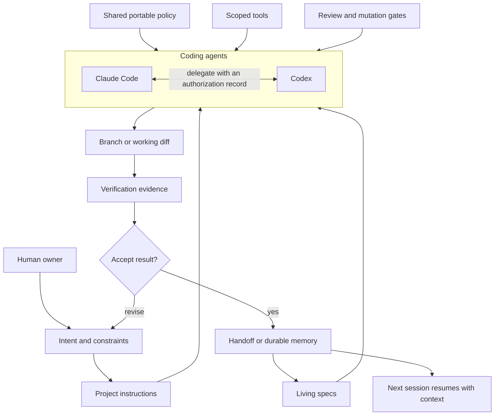
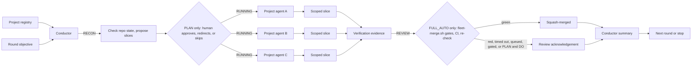
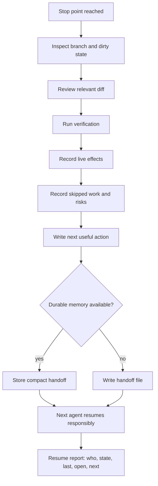
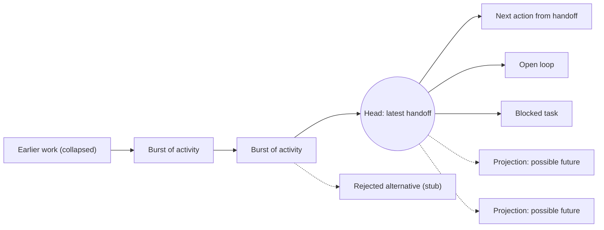
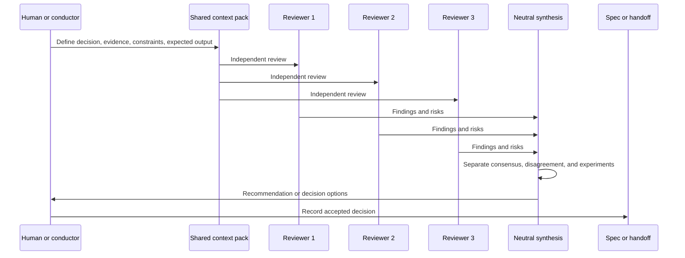
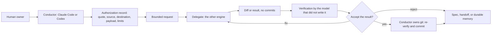
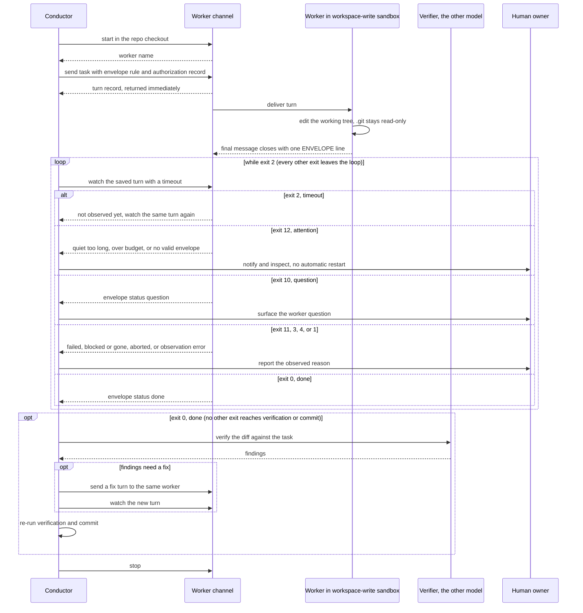
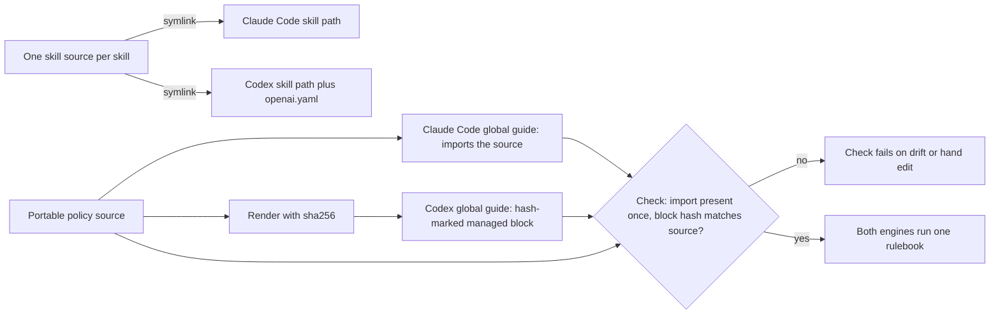
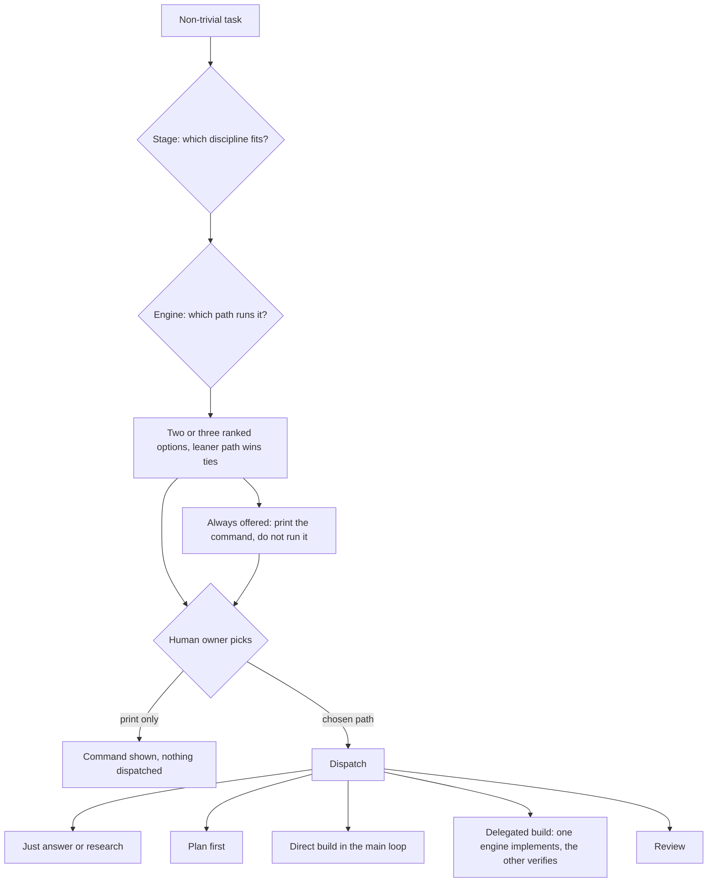
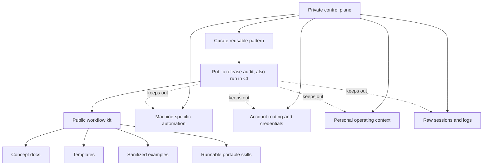

# Workflow Diagrams

These Mermaid diagrams show the operating patterns in this repository at a glance. They describe
reusable workflow shapes for two engines, Claude Code and Codex, under one policy. They are
intentionally public-safe: no private machine wiring, accounts, or project inventories.

## Agentic Operating System

The model is only one part of the system. Instructions, specs, tools, gates, verification, and
handoffs turn isolated agent runs into an inspectable engineering workflow. One shared policy
reaches both engines, and authorization travels with delegated work as a quoted record; see
[One Policy, Two Engines](#one-policy-two-engines) and
[Claude And Codex Delegation](#claude-and-codex-delegation).

## Fleet Round

A fleet round keeps one conductor responsible for scope and review while each project agent works
inside one repository on one narrow slice. Claude Code conducts and is the safety boundary; each
project agent is a Codex session. PLAN, the default, waits for the human to approve each slice; DO
skips only that gate; FULL_AUTO also merges, but only through the fail-closed merge helper, and any
slice it cannot merge stays in review for a human. See
[Fleet execution](concepts/fleet-execution.md) and [Codex fleet](workflows/codex-fleet.md).

## Closeout And Handoff

Closeout is not a transcript dump. It is a compact state record that tells the next session
where the work lives, what changed, what was proved, and what to do next. The read side is a
fixed-format resume report, so a Codex session can pick up a Claude Code handoff and the reverse.

## Project Trajectory And Possible Futures

The trajectory is a view over the same durable captures. Solid futures derive from recorded
facts: next actions, open loops, task state. Dashed ghosts are projections, possible futures an
agent wrote down at closeout, each with a confidence and superseded by the next projection set.
Rejected alternatives stay behind the head as dead stubs. See
[Project trajectory](concepts/project-trajectory.md).

## Council Review

Council review is useful when independent disagreement can improve a decision. It ends with a
recorded decision, experiment, or explicit deferral.

## Claude And Codex Delegation

Either engine can lead. Usually Claude Code conducts and Codex implements well-specified work, but
a Codex-led session delegates to Claude Code the same way. Delegation does not transfer ownership
of truth or authority: the request carries the human's quoted approval and nothing more, the model
that did not write the change verifies it, fixes go back to the same delegate, and only the
conductor touches git. See [Authorization provenance](concepts/authorization-provenance.md),
[Codex from Claude](workflows/codex-from-claude.md), and
[Claude from Codex](workflows/claude-from-codex.md).

## Supervised Delegation

Send and wait are separate calls, so waiting is restartable from the turn record alone. A timeout
means "not observed yet", never "resend", and attention means a person should look, not that the
worker should be killed. The worker cannot write `.git`, so the conductor reviews, re-verifies,
and commits. The full contract and exit-code table are in
[Supervised delegation](concepts/supervised-delegation.md); a public reference adapter lives at
[`scripts/codex-runner`](../scripts/codex-runner).

## One Policy, Two Engines

The rules that matter most, such as who commits, what needs a gate, and how authorization travels,
are written once and reach both engines from the same source. Skills are linked, never copied, so
an improvement made in one client is live in the other. A check command fails when a rendered
block no longer matches its source. See
[One policy, two engines](concepts/one-policy-two-engines.md),
[`templates/portable-policy.md`](../templates/portable-policy.md), and
[`templates/skill-registry.md`](../templates/skill-registry.md).

## Execution-Path Triage

Triage runs in the main loop, with no classifier subagent, before any heavy workflow starts. It
asks which stage discipline fits (interview, prototype, spec, diagnose, test-first, module design,
domain modeling, or conflict resolution), then which engine runs it (just-answer, research, plan
first, direct build, delegated build, or review), and the human owner picks from ranked options.
The gate exists because one default-to-heavy run burned about 11.75M tokens across 317 agents and
produced no diff. The working mode is chosen separately: prototype for end-to-end slices verified
through use, or sdlc for plan and review checkpoints.

## Public And Private Boundary

The public artifact is the pattern, not the private implementation. A release audit keeps private
wiring, credentials, personal context, and raw logs out of the published kit.
